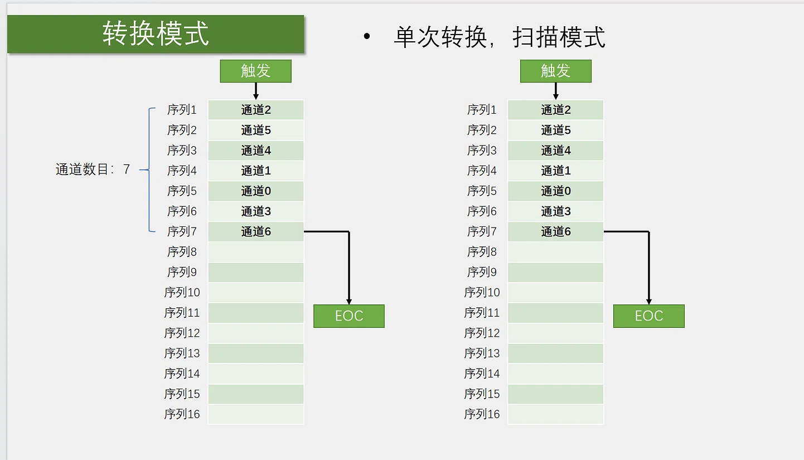
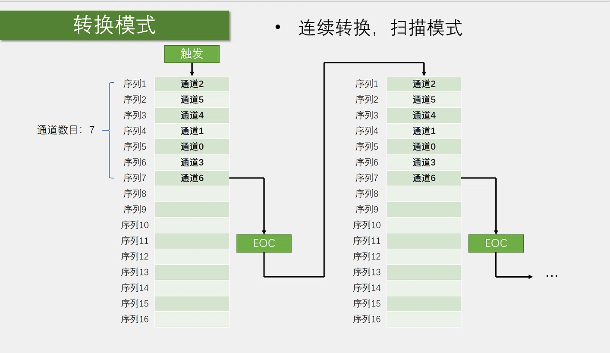

# 8-2 DMA+AD多通道学习记录

## 一、实验功能

使用 ADC1 的 4 个通道（通道 0~3，对应 PA0~PA3），配合 DMA1 通道 1，自动把 ADC 转换结果搬运到数组 `AD_Value[4]` 中。OLED 显示 4 个通道的 AD 值和电压值。

---

## 二、硬件接线

| 外设 | 引脚 |
|---|---|
| 电位器 1 | PA0（通道 0） |
| 电位器 2 | PA1（通道 1） |
| 电位器 3 | PA2（通道 2） |
| 电位器 4 | PA3（通道 3） |
| OLED SCL | PB8 |
| OLED SDA | PB9 |

---

## 三、核心知识点

### 1. ADC 的两种转换模式

| 模式 | 特点 | 适用场景 |
|---|---|---|
| **单次转换** | 转完一轮就停，等下次触发 | 按需采集 |
| **连续转换** | 转完一轮自动重新开始，一直转 | 实时采集 |

### 2. ADC 的扫描模式

| 模式 | 特点 |
|---|---|
| **非扫描** | 只转序列里的 1 个通道 |
| **扫描** | 按序列依次转换多个通道 |

**多通道采集必须开启扫描模式。**

### 3. ADC 的四种组合

| ADC 转换模式 | ADC 扫描模式 | DMA 模式 | 特点 |
|---|---|---|---|
| 单次 | 非扫描 | 普通 | 转 1 个通道，搬 1 次 |
| 单次 | 扫描 | 普通 | 转 N 个通道，搬 N 次，停 |
| 连续 | 非扫描 | 循环 | 一直转 1 个通道，一直搬 |
| **连续** | **扫描** | **循环** | **一直转 N 个通道，一直搬** |

**本实验用最后一种**：连续转换 + 扫描模式 + DMA 循环模式。

### 4. DMA 配置要点

| 参数 | 值 | 含义 |
|---|---|---|
| **外设地址** | `&ADC1->DR` | ADC 数据寄存器 |
| **外设数据宽度** | `DMA_PeripheralDataSize_HalfWord` | 16 位，对应 ADC 数据 |
| **外设地址自增** | `DMA_PeripheralInc_Disable` | 始终以 ADC 数据寄存器为源 |
| **内存地址** | `AD_Value` | 存放 AD 结果的数组 |
| **内存数据宽度** | `DMA_MemoryDataSize_HalfWord` | 16 位，与源数据对应 |
| **内存地址自增** | `DMA_MemoryInc_Enable` | 每次转运后数组移到下一个位置 |
| **传输方向** | `DMA_DIR_PeripheralSRC` | 外设 → 内存 |
| **传输数量** | 4 | 与 ADC 通道数一致 |
| **模式** | `DMA_Mode_Circular` | 循环模式，与连续转换一致 |
| **M2M** | `DMA_M2M_Disable` | 由 ADC 外设触发，不是内存到内存 |
| **优先级** | `DMA_Priority_Medium` | 中等 |

### 5. ADC 和 DMA 的配合：生产者与搬运工

**ADC 和 DMA 的连接，本质是"生产者"和"搬运工"的关系。**

#### 各自的分工

| 外设 | 角色 | 作用 |
|---|---|---|
| **ADC** | 生产者 | 把模拟电压转成数字，存到自己的数据寄存器 `ADC1->DR` |
| **DMA** | 搬运工 | 把 `ADC1->DR` 里的数据搬到内存数组 `AD_Value[]` |

- **没有 DMA**：ADC 转完一次，CPU 必须手动读 `ADC1->DR`，存到数组。
- **有 DMA**：ADC 转完一次，DMA 自动把 `ADC1->DR` 搬到数组，CPU 不用管。

#### 连接的关键：DMA 请求

**ADC 和 DMA 通过"DMA 请求"连接。**

- ADC 每次转换完成，会产生一个 **DMA 请求**（硬件信号）。
- DMA 收到请求，自动把 `ADC1->DR` 的数据搬到内存。
- 搬完后，DMA 等待下一次请求。

这个连接是硬件自动的，代码里只需要使能它：

```c
ADC_DMACmd(ADC1, ENABLE);   // 使能 ADC 的 DMA 请求
```

**不调用这行，ADC 转换完成不会触发 DMA，DMA 不会搬数据。**

#### 连接的代码顺序

**ADC 初始化**：

```c
ADC_InitStructure.ADC_ContinuousConvMode = ENABLE;   // 连续转换
ADC_InitStructure.ADC_ScanConvMode = ENABLE;         // 扫描模式
ADC_InitStructure.ADC_NbrOfChannel = 4;              // 4 个通道
ADC_Init(ADC1, &ADC_InitStructure);
```

**DMA 初始化**：

```c
DMA_InitStructure.DMA_PeripheralBaseAddr = (uint32_t)&ADC1->DR;   // 源：ADC 数据寄存器
DMA_InitStructure.DMA_MemoryBaseAddr = (uint32_t)AD_Value;        // 目标：数组
DMA_InitStructure.DMA_DIR = DMA_DIR_PeripheralSRC;                // 方向：外设 → 内存
DMA_InitStructure.DMA_BufferSize = 4;                             // 搬 4 次
DMA_InitStructure.DMA_Mode = DMA_Mode_Circular;                   // 循环模式
DMA_Init(DMA1_Channel1, &DMA_InitStructure);
```

**连接 ADC 和 DMA**：

```c
DMA_Cmd(DMA1_Channel1, ENABLE);    // 使能 DMA 通道
ADC_DMACmd(ADC1, ENABLE);          // ✅ 使能 ADC 的 DMA 请求，连接 ADC 和 DMA
ADC_Cmd(ADC1, ENABLE);             // 使能 ADC
```

**触发转换**：

```c
ADC_SoftwareStartConvCmd(ADC1, ENABLE);   // 触发一次，之后连续转换
```

#### 完整工作流程

```
1. ADC 转换通道 0 → 结果存入 ADC1->DR
2. ADC 产生 DMA 请求
3. DMA 收到请求，把 ADC1->DR 搬到 AD_Value[0]
4. ADC 转换通道 1 → 结果存入 ADC1->DR
5. DMA 把 ADC1->DR 搬到 AD_Value[1]
6. ADC 转换通道 2 → AD_Value[2]
7. ADC 转换通道 3 → AD_Value[3]
8. DMA 搬完 4 次，循环模式重新开始
9. ADC 继续转换通道 0，DMA 继续搬
```

**CPU 完全不参与，数组 `AD_Value` 始终是最新的 4 个通道数据。**

#### 生活比喻

**ADC 是"厨师"**，做出一道菜（转换结果），放在出餐口（`ADC1->DR`）。

**DMA 是"服务员"**，听到厨师按铃（DMA 请求），就把菜从出餐口端到餐桌（`AD_Value`）。

**`ADC_DMACmd(ADC1, ENABLE)` 就是"把厨师的铃接到服务员的耳朵上"**——不接，厨师按铃服务员听不到，菜一直放在出餐口，没人端。

### 6. 关键函数

| 函数 | 作用 |
|---|---|
| `RCC_AHBPeriphClockCmd(RCC_AHBPeriph_DMA1, ENABLE)` | 开 DMA1 时钟 |
| `ADC_DMACmd(ADC1, ENABLE)` | 使能 ADC 的 DMA 请求 |
| `ADC_SoftwareStartConvCmd(ADC1, ENABLE)` | 软件触发 ADC 转换 |
| `DMA_Cmd(DMA1_Channel1, ENABLE)` | 使能 DMA 通道 |

---

## 四、单次转换 vs 连续转换

### 单次转换 + 扫描 + DMA 普通模式



**流程**：
1. 触发一次。
2. ADC 按序列转换 4 个通道。
3. DMA 搬 4 个数据到数组。
4. 停，等下次触发。

**代码**：
```c
ADC_InitStructure.ADC_ContinuousConvMode = DISABLE;
DMA_InitStructure.DMA_Mode = DMA_Mode_Normal;
```

**特点**：按需采集，调用 `AD_GetValue()` 时才更新数据。

### 连续转换 + 扫描 + DMA 循环模式



**流程**：
1. 触发一次。
2. ADC 一直转，DMA 一直搬。
3. 数组里始终是最新的 4 个通道数据。

**代码**：
```c
ADC_InitStructure.ADC_ContinuousConvMode = ENABLE;
DMA_InitStructure.DMA_Mode = DMA_Mode_Circular;
ADC_SoftwareStartConvCmd(ADC1, ENABLE);   // 初始化最后触发一次
```

**特点**：实时采集，数组一直更新，CPU 完全不参与。

---

## 五、重点

1. **多通道采集必须开启扫描模式**，`ADC_ScanConvMode = ENABLE`。
2. **连续转换配循环模式**，ADC 一直转，DMA 一直搬。
3. **DMA 外设地址不自增**（`DMA_PeripheralInc_Disable`），因为 ADC 数据寄存器地址固定。
4. **DMA 内存地址自增**（`DMA_MemoryInc_Enable`），每次搬到数组的下一个位置。
5. **数据宽度必须匹配**：ADC 是 16 位，DMA 外设和内存都用 `HalfWord`。
6. **传输数量等于 ADC 通道数**，4 个通道就搬 4 次。
7. **`ADC_DMACmd(ADC1, ENABLE)` 必须调用**，否则 ADC 转换完成不会触发 DMA。
8. **`ADC_SoftwareStartConvCmd` 触发一次即可**，连续转换模式下会自动循环。

---

## 六、注意事项

1. **连续转换 + 循环模式下，数组一直更新**，主循环直接读数组即可。
2. **ADC 和 DMA 初始化顺序**：先配 ADC 规则组，再配 DMA，最后使能。
3. **DMA 传输数量要和 ADC 通道数一致**，否则数据错位。
4. **数组类型必须是 `uint16_t`**，因为 ADC 是 12 位数据。
5. **ADC 采样时间根据信号源阻抗选择**，55.5 周期是常用中等值。

---

## 七、经验总结

1. **ADC + DMA 是 STM32 最经典的自动采集方案**，CPU 完全不参与。
2. **连续转换 + 扫描模式 + DMA 循环模式**，实现实时多通道采集。
3. **单次转换 + 扫描模式 + DMA 普通模式**，实现按需采集。
4. **DMA 外设地址不自增，内存地址自增**，这是 ADC + DMA 的标准配置。
5. **数据宽度必须匹配**：ADC 16 位，DMA 用 `HalfWord`。
6. **传输数量等于通道数**，4 个通道搬 4 次。
7. **`ADC_DMACmd` 使能 ADC 的 DMA 请求**，不调用 DMA 不工作。
8. **连续转换只需触发一次**，ADC 会自动循环，DMA 会自动搬运。
9. **一句话总结：ADC 是生产者，DMA 是搬运工，`ADC_DMACmd(ADC1, ENABLE)` 是它们之间的"连接线"**——ADC 每转换一次产生 DMA 请求，DMA 自动把数据搬到数组，CPU 完全不参与。
